# ⚡ Joule Receipts

**The offline energy copilot that proves every saving: for your laptop, your code, and even its own AI.**

Joule Receipts measures real power on your laptop, uses a small local AI to explain what to change, and then
**proves** each saving with a receipt: baseline and optimized runs, alternated, measured with Apple's power sensor
and tested statistically. Receipts are hash-chained, so they cannot be quietly edited, and everything syncs to a
cloud server when the network returns: no data lost, nothing duplicated.

| | |
|---|---|
| **Problem statement** | PS 04: Energy-Aware AI, Offline-First Copilot (local SLM under 4B parameters) |
| **Member** | Subhash Kashyap K H · 1MS24CI128 · CSE (AI & ML) |
| **Local AI** | Qwen2.5-0.5B → Qwen2.5-1.5B cascade (0.49B / 1.54B, Apache-2.0) via Ollama, 4-bit, 100% offline |
| **Hardware** | Apple M3 MacBook Air, macOS |
| **Headline results** | −71% · −94% · −56% · −99% energy, all **MEASURED** and statistically significant (p < 0.01) |
| **Tests** | 57 automated tests (standard-library `unittest`), CI on Ubuntu + macOS |

**Documentation:** [Certification and deterministic rules](docs/CERTIFICATION_AND_RULES.md) (how a certificate
is given, every threshold and formula) · [Technical knowledge](docs/TECHNOLOGY.md) (every technology: what, why,
where, why it matters)

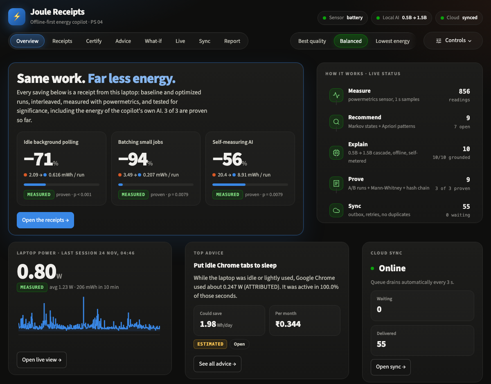

<sub>**Demo screenshot** · Dashboard Overview: three proven savings, all MEASURED, plus the live pipeline status.</sub>

---

## Contents

1. [The problem](#1-the-problem)
2. [Existing solutions and their limits](#2-existing-solutions-and-their-limits)
3. [What Joule Receipts does](#3-what-joule-receipts-does)
4. [How PS 04 is met](#4-how-each-ps-04-requirement-is-met)
5. [Results](#5-results-measured-on-an-apple-m3)
6. [Architecture and flowcharts](#6-architecture-and-flowcharts)
7. [Tech stack](#7-tech-stack)
8. [Measurement method](#8-measurement-method)
9. [Proving the savings](#9-proving-the-savings)
10. [Offline-first sync](#10-offline-first-sync)
11. [Demo screenshots](#11-demo-screenshots)
12. [Run it](#12-run-it)
13. [Code map](#13-code-map)
14. [Roadmap and references](#14-roadmap-and-references)
15. More docs: [Certification and rules](docs/CERTIFICATION_AND_RULES.md) · [Technical knowledge](docs/TECHNOLOGY.md)

---

## 1. The problem

* **What:** laptops waste power in background apps, frequent wake-ups and oversized AI runs. Tools show CPU % and
  vague "energy impact" scores: no watts, no ₹, no next step, and no proof that advice worked.
* **Who it affects:** students, campus labs, small offices and developers running AI and code on laptops.
* **Why it matters:** hidden waste costs money and CO₂. Cloud AI assistants need internet, send data out, and can
  invent numbers.

## 2. Existing solutions and their limits

| Existing solution | What it does | Limitation |
|---|---|---|
| Activity Monitor · powertop | Show readings | Relative scores; no ₹, no advice, no proof |
| CodeCarbon · Scaphandre · CarbonLint | Estimate software energy / CO₂ | Mostly estimates; never check whether a fix worked |
| Green Metrics Tool | Measures software in containers | Linux/server setup; no advice; results not tamper-proof |
| Cactus Compute · RunAnywhere · Sentient OS (YC) | Small AI running on-device | Never measure their own AI's energy |
| DeepAware AI · Edviro (YC) | AI that saves data-centre energy | Data centres only; DeepAware's 15% claim is from simulation |
| Unravel Carbon · SINAI · CarbonChain (YC) | Company carbon accounting | From spending data, not device watts |
| Ramp Router · Martian · RouteLLM | Send easy requests to a smaller model | Save money, never measure the energy saved |
| Cloud AI assistants | Chat-based tips | Need internet, send data out, can invent numbers |

**The gap:** no tool closes the loop *measure → recommend → prove*, offline, with evidence you can trust.

## 3. What Joule Receipts does

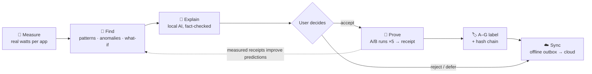

| Feature | What it means for the user |
|---|---|
| **Live power per app** | Real watts every second from Apple's sensor, split across apps (Chrome, VS Code, …) |
| **Trust label on every number** | `MEASURED` · `ATTRIBUTED` · `ESTIMATED` · `SIMULATED`; a combined number takes the weakest label |
| **Recommendations** | Background hogs, apps that spike together (Apriori), frequent wake-ups (Markov chain) |
| **Anomaly alerts** | "Chrome is using 3× its usual power right now"; clears itself when power is back to normal |
| **Local AI explanations** | Qwen 0.5B first; 1.5B only if a fact-checker finds an invented number; template as last resort |
| **The AI meters itself** | Each explanation shows its own energy, e.g. `⚡ 6.8 J · MEASURED · 0.5B ✓` |
| **Receipts** | Every saving proven by alternating runs, medians and an exact Mann–Whitney test |
| **A–G energy label** | Like an appliance sticker; **CERTIFIED** only if measured, significant, same work, chain intact |
| **Certify your own code** | Old vs new version of any program → measured receipt, label and HTML certificate |
| **What-if simulator** | Sliders whose curves pass through the two settings a receipt actually measured |
| **Goal switch** | Best quality / Balanced / Lowest energy: which AI model, alert sensitivity, which tips are shown |
| **Tamper-evident chain** | SHA-256 chain over all receipts; the cloud re-verifies it independently |
| **Offline outbox** | Survives restarts, retries with backoff, no duplicates, syncs automatically on reconnect |

## 4. How each PS 04 requirement is met

| PS 04 requirement | How |
|---|---|
| Local SLM < 4B, offline | Qwen2.5 0.5B / 1.5B on Ollama at `localhost`; no cloud API anywhere (`joule/slm/`) |
| Energy: method, interval, hardware, limitations | powermetrics 1 s windows on Apple M3, with fallbacks; every value carries a trust label ([§8](#8-measurement-method)) |
| Predict, recommend, explain with the SLM | Analytics compute the facts; the SLM only writes the explanation, and a grounding check rejects invented numbers |
| Persistent outbox: restarts, retries, no duplicates, auto-sync | SQLite transactional outbox + idempotency keys + sync worker + Docker cloud server ([§10](#10-offline-first-sync)) |
| Prove savings: baseline vs optimized in Wh, ₹, CO₂e | A/B experiments with receipts ([§9](#9-proving-the-savings)); ₹ at BESCOM ₹5.80/kWh, CO₂e at 0.716 kg/kWh |
| Measured vs estimated kept separate | `MEASURED` / `ATTRIBUTED` / `ESTIMATED` / `SIMULATED` on every number, in the UI, receipts and reports |

## 5. Results (measured on an Apple M3)

All four results: **MEASURED** with `powermetrics`, medians of interleaved runs, exact Mann–Whitney test.

| # | Test | Baseline | Optimized | Saving | Evidence | Label |
|---|---|---|---|---|---|---|
| 7 | Idle polling: check every 0.1 s → every 2 s | 2.09 mWh/min | 0.62 mWh/min | **−71%** | 10 + 10 runs, p < 0.001, 100/100 pairs lower | **B · CERTIFIED** |
| 5 | Batching: 200 launches → 10 launches (same 200 jobs) | 3.49 mWh | 0.21 mWh | **−94%** | 5 + 5 runs, p = 0.008, pilot predicted within 0.3% | **A · CERTIFIED** |
| 8 | Own AI: always 1.5B → 0.5B first (6 answers) | 20.4 mWh | 8.91 mWh | **−56%** | 5 + 5 runs, p = 0.008, 25/25 pairs, 6/6 fact-checked | **C · CERTIFIED** |
| 9 | Your code: prime counter v1 → v2 (identical output) | 3.12 mWh/run | 0.02 mWh/run | **−99%** | 5 + 5 runs, p = 0.008, ~2 s vs 0.02 s per run | **A · CERTIFIED** |

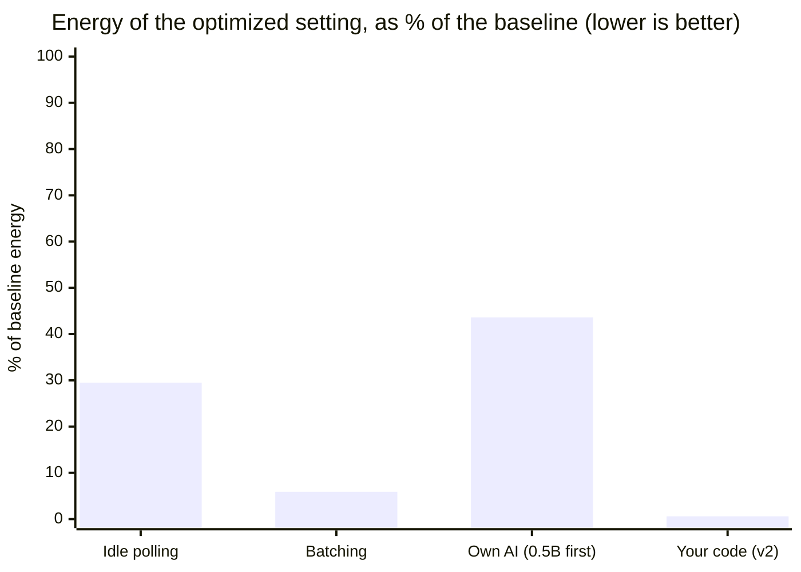

**The AI measuring itself (receipt #8).** Every one of the five 0.5B-first runs used less energy than every 1.5B run,
even as the laptop's power drifted down during the test; that drift is why runs alternate.

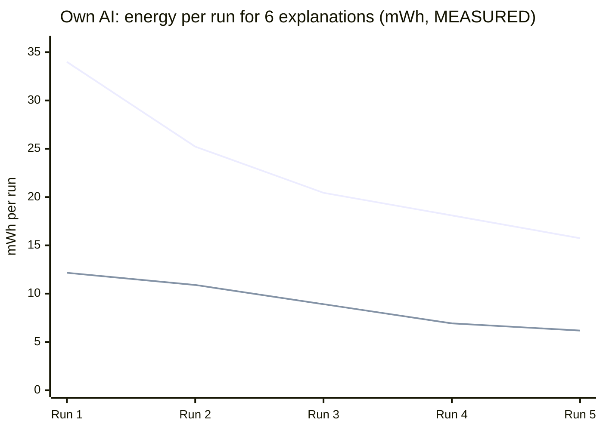
<sub>Upper line: always Qwen 1.5B · lower line: 0.5B first, 1.5B only if the fact check fails (it never had to).</sub>

**Software certification (receipt #9):** v1 used 3.04–3.18 mWh per run, v2 0.019–0.021 mWh. v2 is so fast that
it was repeated ~700 times in each 15 s measurement window and the energy divided per run.

**A real 15-minute session** (642 MEASURED readings, 0 errors): average 1.32 W (CPU 0.95 W + GPU 0.38 W), resting
0.65 W, peak 8.5 W, 0.33 Wh in total, ~437 short wake-ups per hour. **Chrome alone was ~25% of chip power.**

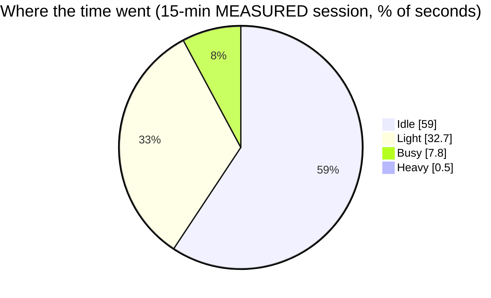

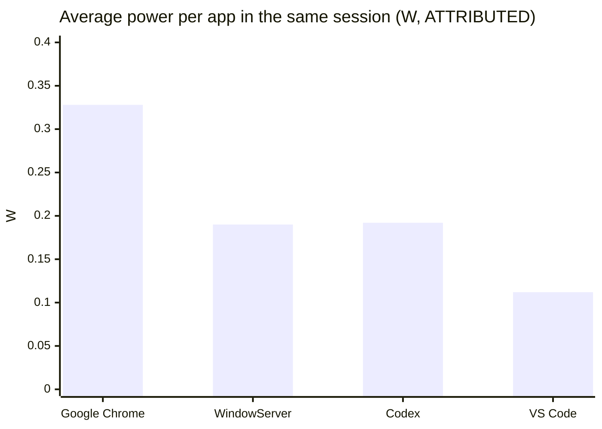

**Sync and integrity:** 55 items delivered, 0 rejected, 0 lost, **0 duplicates** stored by the cloud; the cloud
re-verified all 9 receipts in the hash chain and its head matches the laptop's.

**Honesty in practice:** the first idle attempt (8 runs, other apps busy) was *not* significant (p = 0.33), so the
app stamped it NOT PROVEN until a quiet 10-run rerun proved it. An early batching run looked like "100.22% saved"
because runs were shorter than one sensor window; fast workloads are now repeated to fill the window.

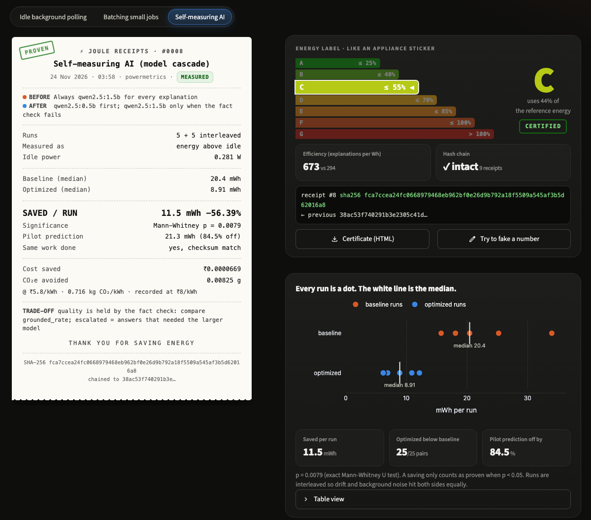

<sub>**Result screenshot** · Receipts page: the AI receipt (−56.39%, p = 0.0079), its C label (CERTIFIED), the
SHA-256 hash, and every run as a dot.</sub>

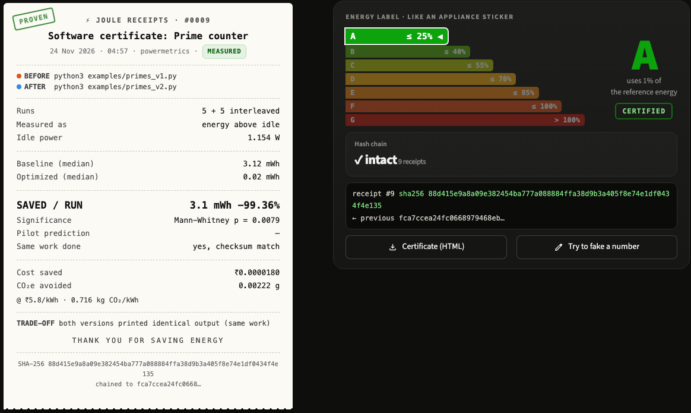

<sub>**Result screenshot** · Certify page: prime counter v2 uses 1% of v1's energy, grade A, CERTIFIED,
hash-chained.</sub>

## 6. Architecture and flowcharts

### System architecture

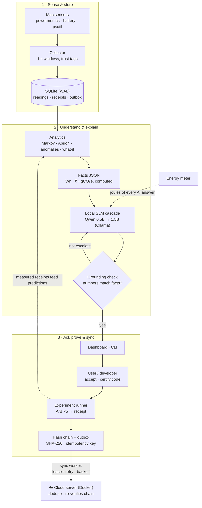

**Why the SLM never computes numbers:** small models make arithmetic mistakes, so the deterministic engine computes
every number and the SLM only turns facts into sentences. `joule/slm/grounding.py` extracts every number from the
AI's text and rejects it if a number is not in the facts.

### The self-measuring AI cascade

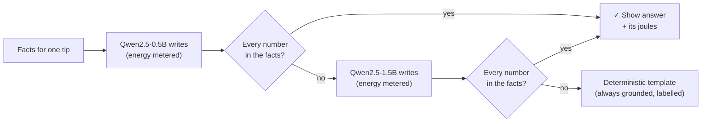

The Goal switch picks the chain: **Best quality** = 1.5B only · **Balanced** = 0.5B → 1.5B · **Lowest energy** = 0.5B
only.

### Certifying a developer's software

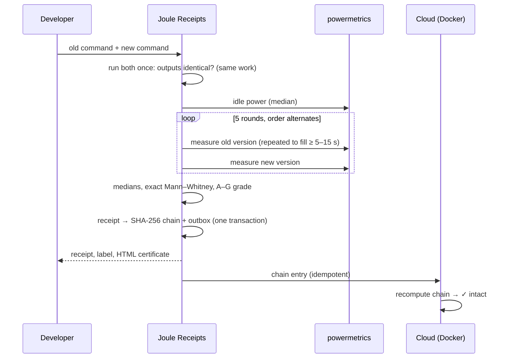

### Outbox item lifecycle

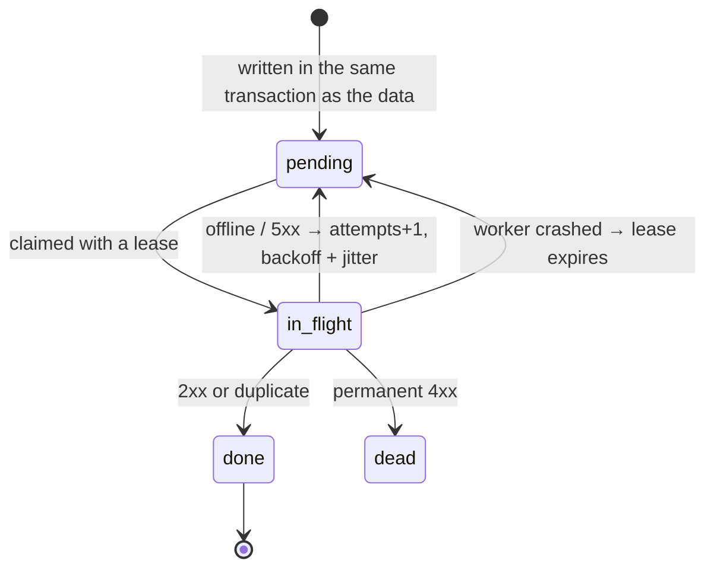

## 7. Tech stack

| Layer | Choice | Why |
|---|---|---|
| Language | Python 3.12 (core uses only the standard library) | One language for sensing, AI and UI |
| Local AI | Qwen2.5 0.5B → 1.5B cascade, Ollama, 4-bit | Under 4B, offline, fact-checked |
| Measurement | macOS `powermetrics` (1 s) · battery gauge · `psutil` | Real watts, no extra hardware |
| Analytics | Markov chain · Apriori · exact Mann–Whitney (hand-written) | Light and explainable |
| Database | SQLite (WAL, `synchronous=FULL`) · transactional outbox · SHA-256 chain | Crash-safe, tamper-evident |
| Backend / sync | Python `http.server` in Docker · idempotency keys | Safe retries, no duplicates |
| Frontend | Streamlit · Plotly · HTML certificates | Readable, fast to build |
| Quality / deploy | 57 `unittest` tests · GitHub Actions (Ubuntu + macOS) · Docker Compose · Makefile | One command reproduces it |

**Why a small local model?** Private (data never leaves the laptop), works with no internet, and cheaper: the 0.5B
model answered 6/6 checks with 56% less energy than 1.5B, measured.
**Data:** no external dataset; every number is measured on the device. **APIs:** only Ollama's local HTTP API.

## 8. Measurement method

| Source | Label | What it measures | Interval | Needs | Limitations |
|---|---|---|---|---|---|
| `powermetrics` (Apple) | **MEASURED** | CPU + GPU + Neural Engine power of the chip | 1 s windows (~1.4 s apart with per-app tracking) | `sudo` | Chip only: excludes display, SSD, Wi-Fi |
| Battery gauge (`ioreg`) | **MEASURED** | Whole-laptop power = voltage × current | gauge refreshes every ~12–33 s | running on battery | Slow; lags load changes; only for long windows |
| CPU-utilisation model | **ESTIMATED** | `P = P_idle + (P_max − P_idle) × CPU%` | 1 s | nothing | Constants are assumptions until `joule calibrate`; cannot see the GPU |
| Per-app share | **ATTRIBUTED** | App W = CPU power × app's CPU share; helpers grouped into their app | 1 s | nothing | CPU share ≠ energy share (GPU, I/O ignored) |
| Simulated sensor | **SIMULATED** | Seeded model of CPU work | 1 s | nothing | For CI, Docker and machines without a Mac; never mixed with measured results |

`auto` picks powermetrics → battery → CPU estimate. Any number computed from several inputs takes the **weakest** label.

## 9. Proving the savings

```
E (Wh)      = Σ ½ (Pᵢ + Pᵢ₊₁) · (tᵢ₊₁ − tᵢ) ÷ 3600          trapezoidal integration of power samples
Net E (Wh)  = E_run − P_idle × t_run ÷ 3600                  only the workload's own energy
Cost (₹)    = E (kWh) × tariff (₹/kWh)
CO₂e (g)    = E (kWh) × grid emission factor (kg/kWh) × 1000
Saving      = median(baseline) − median(optimized);  significant if exact Mann–Whitney p < 0.05
Label       = optimized ÷ baseline:  A ≤ 25% · B ≤ 40% · C ≤ 55% · D ≤ 70% · E ≤ 85% · F ≤ 100% · G > 100%
```

**Protocol:** settle 5 s → measure idle power (median) → small pilot run predicts the saving → baseline and optimized
**interleaved** (B, O, O, B, …) ×5 → medians + exact Mann–Whitney → same-work check (checksums / identical output)
→ receipt (predicted vs measured, Wh, ₹, CO₂e, trade-off) → SHA-256 chain → outbox.

| Scenario | Baseline | Optimized | Same work? |
|---|---|---|---|
| `idle` | Folder-sync poller scans and hashes 200 files every 0.1 s | Same poller every 2 s | Same change detected |
| `batching` | 200 hashing jobs, one process launch per job | Same 200 jobs in 10 launches | Identical output checksum |
| `cascade` | Always Qwen 1.5B for 6 explanations | 0.5B first, 1.5B only if the fact check fails | Same prompts; grounded rate reported |
| `certify` | Your program, old version | Your program, new version | Identical stdout (SHA-256) |

| Assumption | Value | Source |
|---|---|---|
| Electricity tariff | ₹5.80 / kWh (`JOULE_TARIFF`) | BESCOM Domestic (LT-1) base energy rate, FY 2026–27 (energy charge only) |
| Grid emission factor | 0.716 kg CO₂ / kWh (`JOULE_GRID_FACTOR`) | Approx. CEA CO₂ Baseline Database, Indian grid weighted average |

Receipts recorded before the BESCOM rate was set keep the ₹8 placeholder they were made with: receipts are
hash-chained and never rewritten; the dashboard shows the cost at today's rate next to it.

## 10. Offline-first sync

* **Transactional outbox:** a decision, receipt or report and its outbox item are written in **one SQLite
  transaction**, so a crash can never leave one without the other.
* **Idempotency key** per item (unique locally); the server stores it as a primary key and answers `duplicate` to
  repeats, so a lost response + retry is harmless.
* **Retries:** `next_attempt = now + min(2^(attempts−1) × 2 s, 5 min) × jitter(0.5–1)`; permanent 4xx → `dead`.
* **Leases:** an item claimed by a worker that crashes becomes claimable again when its lease expires.
* **Auto-sync:** the worker checks `GET /health` every 3 s and drains the queue when the cloud is reachable.
* **Chain verification:** every receipt's chain entry is synced; `GET /chain` on the cloud recomputes it.
* **Demo:** the cloud runs in Docker: `docker compose stop cloud` = offline, `docker compose start cloud` = reconnect.
  Fault injection: `JOULE_CLOUD_FAIL_RATE`, `JOULE_CLOUD_DROP_RESPONSE_RATE`.

## 11. Demo screenshots

| | |
|---|---|
| 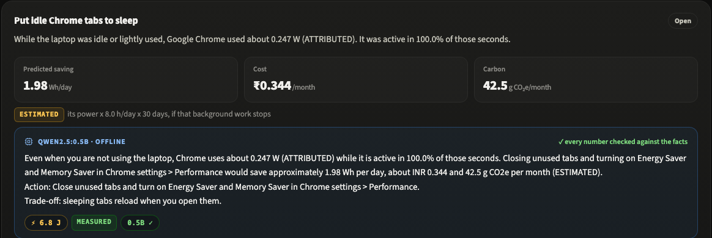 | **Advice:** Chrome used 0.247 W while idle (sensor-based); putting tabs to sleep saves 1.98 Wh/day, ₹0.34 and 42.5 g CO₂e a month. The local 0.5B model wrote the explanation offline, every number passed the fact check, and the answer itself cost 6.8 J. |
| 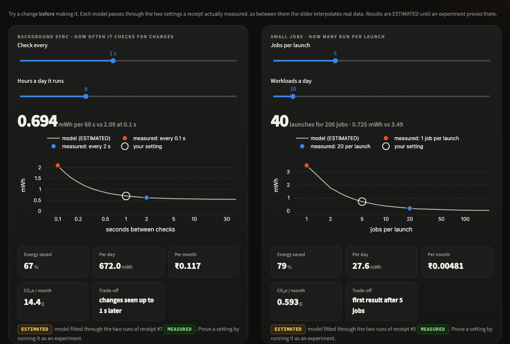 | **What-if:** move a setting and see the energy, ₹ and CO₂ before changing anything. The curve passes through the two settings a receipt measured; outside them it is flagged as extrapolation. |
| 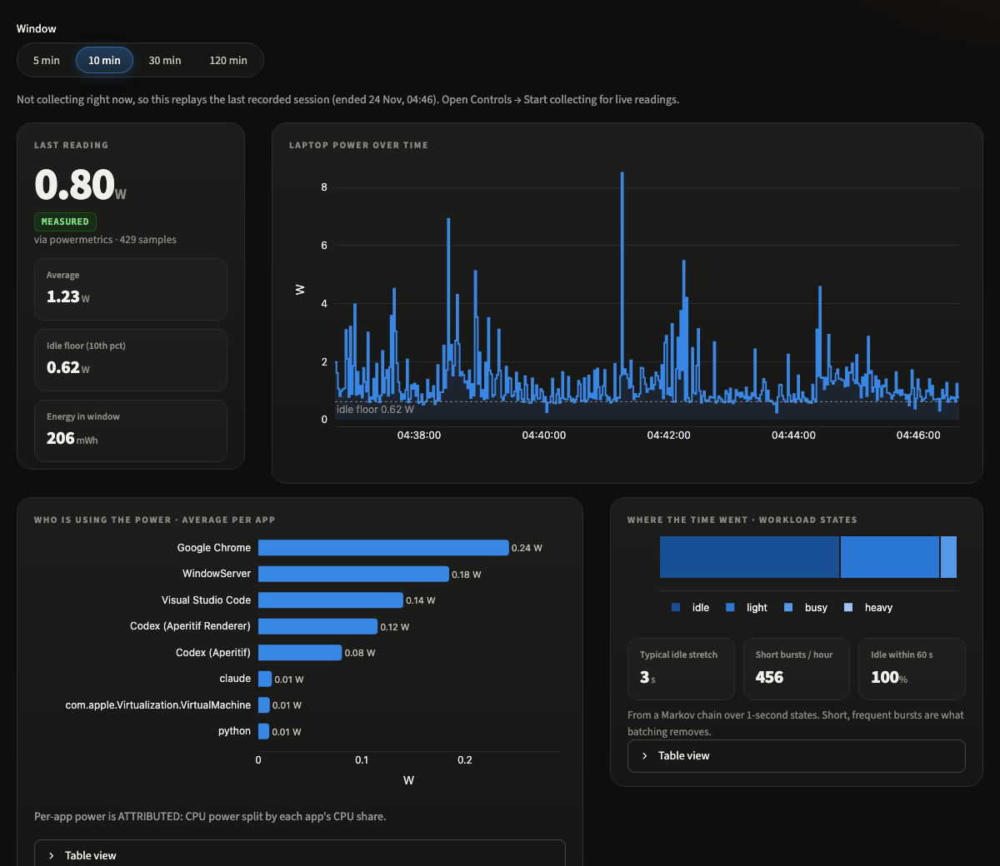 | **Live:** MEASURED power over time, per-app power (ATTRIBUTED), and where the time went (Markov states). |
| 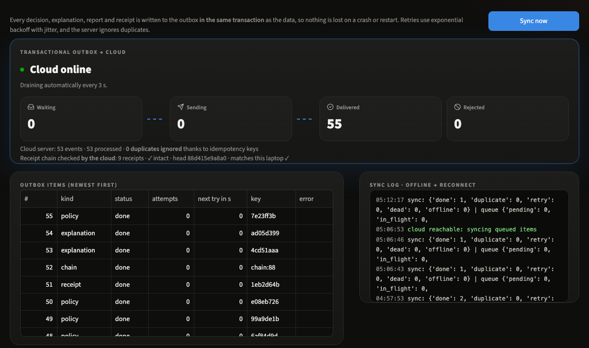 | **Sync:** outbox → cloud, 0 duplicates, and "receipt chain checked by the cloud: 9 receipts, ✓ intact, matches this laptop". |

The dashboard has 8 pages: **Overview · Receipts · Certify · Advice · What-if · Live · Sync · Report**.

## 12. Run it

**One-time setup** (needs ~3 GB):

```bash
brew install ollama && ollama serve &               # local AI server on localhost:11434
ollama pull qwen2.5:0.5b && ollama pull qwen2.5:1.5b
uv venv --python 3.12 .venv && uv pip install --python .venv/bin/python streamlit plotly psutil
docker compose up -d --build cloud                  # cloud sync server on localhost:8787
```

**Every time:**

```bash
ollama serve > /dev/null 2>&1 &
docker compose start cloud
.venv/bin/streamlit run joule/dashboard.py          # http://localhost:8501
```

| What | Where |
|---|---|
| Dashboard (Streamlit) | http://localhost:8501 |
| Local AI (Ollama) | http://localhost:11434 |
| Cloud sync server (Docker) | http://localhost:8787 (`/health`, `/stats`, `/events`, `/chain`) |
| Local database | `data/joule.db` (SQLite) |

**Command line** (`python -m joule …`; the core needs only Python 3.11+):

```bash
python3 -m joule status                         # sensors, AI and queue available right now
python3 -m joule collect --seconds 300          # store readings + per-app attribution
python3 -m joule experiment batching --repeats 5   # idle | batching | inference | cascade
python3 -m joule recommend                      # recommendations from stored data
python3 -m joule explain 1                      # AI explanation via the Goal's cascade, metered
python3 -m joule goal balanced                  # quality | balanced | lowest
python3 -m joule whatif polling 1.0             # simulate a setting (ESTIMATED from a receipt)
python3 -m joule verify --tamper-demo           # chain check + labels + tamper demo (in memory)
python3 -m joule certify --name "My app" --baseline "python3 old.py" --candidate "python3 new.py"
python3 -m joule decide 1 accept                # decision → outbox (one transaction)
python3 -m joule sync --watch                   # auto-sync when the cloud is reachable
python3 -m unittest discover -s tests -t .      # all 57 tests, offline
```

**MEASURED numbers on Apple silicon** need `powermetrics` (asks for your password):

```bash
sudo .venv/bin/python -m joule experiment cascade --source powermetrics --repeats 5
sudo .venv/bin/python -m joule certify --name "Prime counter" --baseline "python3 examples/primes_v1.py" \
     --candidate "python3 examples/primes_v2.py" --source powermetrics
```

## 13. Code map

| Path | What it does |
|---|---|
| `joule/config.py` | Paths, settings, assumptions (tariff, grid factor) with their sources |
| `joule/provenance.py` | MEASURED / ATTRIBUTED / ESTIMATED / SIMULATED and how they combine |
| `joule/energy.py` | W → Wh, net energy, ₹, CO₂e, medians, exact Mann–Whitney |
| `joule/db.py` | SQLite schema, migrations, outbox writes in one transaction, hash chain |
| `joule/chain.py` | SHA-256 receipt chain (standard library; shared with the cloud server) |
| `joule/sensors/` | `powermetrics.py`, `battery.py`, `cpu_estimate.py`, `simulated.py`, `procs.py` |
| `joule/collector.py` | Samples power + per-process CPU and stores them |
| `joule/workloads.py` | Reproducible baseline/optimized workloads doing identical work |
| `joule/experiment.py` | Idle baseline, pilot prediction, interleaved A/B runs, receipts |
| `joule/certify.py` | Certify any program: old vs new command → receipt, label, certificate |
| `joule/policy.py` | The Goal switch (models, alert sensitivity, tip filter), stored and synced |
| `joule/analytics/` | `markov.py`, `apriori.py`, `anomaly.py`, `whatif.py`, `label.py`, `power_model.py`, `knowledge.py`, `recommend.py` |
| `joule/slm/` | `client.py` (Ollama), `grounding.py`, `explain.py` (cascade), `meter.py` (AI energy), `report.py` |
| `joule/sync/` | `outbox.py`, `worker.py`, `server.py` (dedupe + `/chain` verification) |
| `joule/dashboard.py` | Streamlit dashboard (8 pages) |
| `joule/cli.py` | `python -m joule …`: every feature from the command line |
| `examples/` | Two versions of a prime counter with identical output, for the certify demo |
| `tests/` | 57 standard-library tests; run offline in ~20 s |

## 14. Roadmap and references

**Roadmap:** Linux (Intel RAPL) and Windows sensors · lab fleet view across many machines · `joule certify` as a
GitHub Action on every pull request · live grid-carbon data when online · a QR code on certificates.

**References:** Apple `powermetrics(1)` manual · Ollama · Qwen2.5 (Apache-2.0) · CEA CO₂ Baseline Database (Indian
power sector) · BESCOM LT-1 tariff, FY 2026–27 · Mann–Whitney U test (exact).

**Reuse from my learning projects:** the Ollama chat client pattern (`retail-basket-prediction-analyzer`), Apriori
and Markov baselines (`retail-basket-prediction-analyzer`, `learning-path-predictor`), confidence-based "needs review"
flags (`customer-feedback-analyzer`), and the tests + CI + Docker pattern used across them. Third-party credits:
[CREDITS.md](CREDITS.md).
