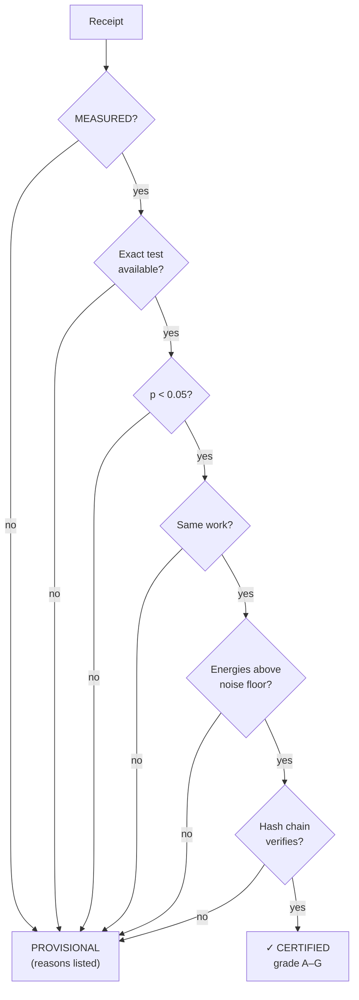

# Certification and deterministic rules

Joule Receipts never lets the AI decide anything that is a number or a verdict. Every number, label, alert,
recommendation and certificate comes from **fixed, written-down rules**, listed here with their exact values and the
file that implements them. The local AI only turns already-computed facts into sentences, and even that is checked
by a rule (§7).

Contents:
1. [How a certificate is given](#1-how-a-certificate-is-given)
2. [The energy label (A–G)](#2-the-energy-label-ag)
3. [The hash chain (tamper evidence)](#3-the-hash-chain-tamper-evidence)
4. [Certifying your own software](#4-certifying-your-own-software)
5. [How an experiment is run and judged](#5-how-an-experiment-is-run-and-judged)
6. [Trust labels (provenance)](#6-trust-labels-provenance)
7. [The AI fact-check (grounding) and the model cascade](#7-the-ai-fact-check-grounding-and-the-model-cascade)
8. [Recommendation rules](#8-recommendation-rules)
9. [Anomaly alert rules](#9-anomaly-alert-rules)
10. [Workload states (Markov chain)](#10-workload-states-markov-chain)
11. [What-if models](#11-what-if-models)
12. [The Goal switch](#12-the-goal-switch)
13. [Energy, cost and CO₂ formulas](#13-energy-cost-and-co₂-formulas)
14. [Sensor selection and attribution](#14-sensor-selection-and-attribution)
15. [Sync rules](#15-sync-rules)

---

## 1. How a certificate is given

Every receipt gets an energy label. The label is **CERTIFIED** only when **all five** conditions hold; otherwise it
is **PROVISIONAL** and the certificate prints every failed condition as the reason.

| # | Condition | Why it matters | Rule in code |
|---|---|---|---|
| 1 | The energy is **MEASURED** | Estimates and simulations cannot certify anything | `body.provenance == "MEASURED"` |
| 2 | The receipt has the **exact significance test** | Older receipts without it cannot be judged the same way | `p_value is not None` |
| 3 | The saving is **statistically significant** | Rules out "saved by luck" | exact Mann–Whitney `p < 0.05` |
| 4 | Both settings did **the same work** | A version that does less work is not "more efficient" | identical checksum / output, same work units; for software, outputs not allowed to differ |
| 5 | The **hash chain verifies** up to this receipt | Proves no receipt was edited after it was made | recomputed SHA-256 chain matches (§3) |

One more guard: if either energy value is at or below zero (energy above idle at the **noise floor**), the ratio
cannot be rated and the label stays provisional.



The certificate (`joule verify --certificate <id>` or the **Certificate (HTML)** button) is a self-contained page
with the grade, the CERTIFIED/PROVISIONAL stamp, both settings, energy per run, efficiency, evidence (runs, p-value,
same work), the sensor, the trade-off, the receipt's SHA-256 hash and the previous hash.

Implemented in `joule/analytics/label.py` (`label_for`, `certificate_html`).

## 2. The energy label (A–G)

**Metric:** the optimized setting's energy as a share of the reference (baseline) setting, for the same work on the
same machine:

```
ratio (%) = max(optimized_wh, 0) ÷ baseline_wh × 100
```

| Grade | Ratio | Meaning |
|---|---|---|
| **A** | ≤ 25% | uses a quarter or less of the reference energy |
| **B** | ≤ 40% | |
| **C** | ≤ 55% | |
| **D** | ≤ 70% | |
| **E** | ≤ 85% | |
| **F** | ≤ 100% | no worse than the reference |
| **G** | > 100% | uses more energy than the reference |

`optimized_wh` and `baseline_wh` are the **medians** of the runs (§5), on the receipt's basis (energy above idle for
fixed-work tests, total energy for fixed-time tests).

**Efficiency figure** printed with the label (useful work per Wh):

| Scenario | Unit | Formula |
|---|---|---|
| `batching` | jobs per Wh | jobs ÷ energy per run |
| `idle` | minutes of watching per Wh | window minutes ÷ energy per window |
| `cascade`, `inference` | explanations per Wh | prompts ÷ energy per run |
| `certify` | program runs per Wh | 1 ÷ energy per program run |

Current labels: idle **B** (29%), batching **A** (6%), own AI **C** (44%), prime counter **A** (1%), all CERTIFIED.

## 3. The hash chain (tamper evidence)

Every receipt is linked to the one before it:

```
hash_n = SHA-256( hash_(n−1) | receipt_id | created_time | canonical_JSON(receipt_body) )
hash_0 = "000…0" (64 zeros, the genesis value)
```

* **Canonical JSON** = keys sorted, so the same body always gives the same bytes.
* The receipt and its hash are written **in the same database transaction**, together with a `chain` event in the
  outbox (idempotency key `chain:<hash>`, so it can never be queued twice).
* **Verification** recomputes every hash in order. The first receipt whose stored `prev_hash` or `hash` does not
  match is reported as `broken_at`. Editing any number in receipt *k* breaks *k*, and every later receipt then points
  to a hash that no longer exists.
* **Independent check:** the cloud server stores the chain events and recomputes the chain itself
  (`GET /chain`). The dashboard shows "checked by the cloud ✓ · matches this laptop" when the cloud's head equals the
  laptop's.
* **Old receipts** made before the chain existed were chained once, in id order, by a database migration.
* **Tamper demo** (`joule verify --tamper-demo`, or "Try to fake a number"): copies the receipts **in memory**,
  changes one receipt's `measured_saved_wh` to `2 × old + 0.001`, re-verifies, and shows the break. The database is
  never touched.

Implemented in `joule/chain.py` (shared by the laptop and the cloud), `joule/db.py`, `joule/sync/server.py`.

## 4. Certifying your own software

`joule certify --name … --baseline "<old command>" --candidate "<new command>"` (or the **Certify** page).

| Step | Rule |
|---|---|
| 1. Pre-check | Run both commands once. A non-zero exit code fails immediately with the program's error. |
| 2. Same work | The SHA-256 of each program's standard output must be **identical**. If not, certification is refused, unless `--allow-different-output` is given (then only a clean exit is required and the label can never be certified). |
| 3. Short programs | Each measured run repeats the program until it lasts at least **5 s** (or the sensor's own minimum: **15 s** for powermetrics, **90 s** for the battery gauge). Energy is divided by the number of repetitions. Every repetition must print the same output as the first. |
| 4. Measure | Same protocol as every experiment (§5): idle power, 5 rounds, order alternating, energy above idle. |
| 5. Judge | Medians, exact Mann–Whitney, A–G grade, CERTIFIED rules (§1). |
| 6. Record | Receipt → hash chain → outbox (one transaction); HTML certificate written to `data/certificates/software-<id>.html`. |

Timeout: 300 s per program run (`--timeout`). Implemented in `joule/certify.py`.

## 5. How an experiment is run and judged

| Rule | Value | Why |
|---|---|---|
| Settle before measuring idle | 5 s (0.5 s with `--quick`) | let the machine calm down after starting |
| Idle window | max(10 s, sensor minimum window); CLI default 20 s | enough readings for a stable idle value |
| Idle power | **median** of the idle readings | one spike from another app barely moves it |
| Pilot prediction | one small baseline + optimized pair at 25% (idle), 20% (batching) or 34% (AI) of full size, scaled up linearly | the receipt compares predicted vs measured |
| Repeats | 5 per setting (10 for the published idle result) | enough for an exact test |
| Order | interleaved; each round alternates which goes first (B, O, then O, B, …) | cancels drift (temperature, battery, background apps) |
| Cool-down between runs | 2 s (0.5 s with `--quick`) | runs do not overlap |
| Minimum run length | 15 s for powermetrics, 90 s for the battery gauge (repeat the work until reached) | slow sensors need long windows |
| Energy of a run | time-weighted mean power × duration (trapezoidal) | §13 |
| Basis | **fixed-time** tests (idle): total energy (both last equally long); **fixed-work** tests: energy **above idle** | compares only the workload's own energy |
| Saving | median(baseline) − median(optimized) | robust to one disturbed run |
| Significance | exact two-sided **Mann–Whitney U** over every possible split (used when total runs ≤ 20); significant if **p < 0.05** | no normality assumption; 5 vs 5 gives p = 0.0079 when every optimized run is lower |
| Also reported | means ± standard deviation, Welch-style noise band = 2 × √(s²_b/n_b + s²_o/n_o) | transparency |
| Same work | one identical checksum across all runs and identical work units | proves both settings did the same job |
| Prediction error | (predicted − measured) ÷ |measured| × 100% | shows how good the forecast was |

Implemented in `joule/experiment.py`, `joule/energy.py`, `joule/workloads.py`.

## 6. Trust labels (provenance)

| Label | Meaning | Sources |
|---|---|---|
| **MEASURED** | read from a real power sensor | powermetrics, battery gauge |
| **ATTRIBUTED** | measured total split by a rule (per-app share) | per-app power from a MEASURED source |
| **ESTIMATED** | computed from a model or assumption | CPU-utilisation model, projections (Wh/day, ₹/month), what-if |
| **SIMULATED** | from the simulation model | simulated sensor (tests, CI, Docker) |

**Combination rule:** a number computed from several inputs takes the **weakest** label, in the order
MEASURED > ATTRIBUTED > ESTIMATED > SIMULATED. Every projection into the future (per day, per month) is at best
ESTIMATED. Implemented in `joule/provenance.py`.

## 7. The AI fact-check (grounding) and the model cascade

**Grounding rule** (`joule/slm/grounding.py`): every number in the AI's text must come from the facts.

| Rule | Detail |
|---|---|
| What counts as a number | digits with optional thousands commas and decimals |
| Not quantities | numbers glued to letters on the left (`CO2`, `Q4`, `qwen2.5`) and list markers at the start of a line (`1.`, `2)`) |
| Always allowed | 0, 1, 100 |
| A number is grounded if | it equals a fact number rounded to the text's number of decimals, **or** is within **1%** of a fact number |
| Facts searched | every numeric value and every number written inside fact strings |
| Verdict | grounded only if **no** ungrounded number remains |

**Model cascade** (`joule/slm/explain.py: explain_cascade`):

1. The smallest model in the Goal's list writes the explanation (max 180 tokens) while the power sensor is sampled.
2. If the text passes the grounding rule → shown, with its energy and the model used.
3. If not → the next, larger model tries.
4. If every model fails (or Ollama is off) → a **deterministic template** built only from fact strings (always
   grounded, labelled "template").

For a single-model call (`explain`), a failed draft gets up to 2 corrective retries: the AI is told which numbers
were not in the facts, with temperature 0.1 + 0.3 × attempt and a fixed seed per attempt.

**AI energy per answer** (`joule/slm/meter.py`): energy = time-weighted mean power while the model wrote × duration;
provenance = the sensor's label.

## 8. Recommendation rules

Implemented in `joule/analytics/recommend.py`. Idle power for these rules = the **10th percentile** of all stored
readings. Numbers shown to the user and the AI are rounded to **3 significant figures**.

| Recommendation | Fires when | Confidence | Prediction |
|---|---|---|---|
| **Background app** ("Put idle Chrome tabs to sleep") | ≥ 20 idle/light readings; an app's average power during them ≥ **0.15 W**; top 3 apps | share of idle/light seconds the app was active | app W × 8 h/day × 30 days |
| **Apps that spike together** (Apriori) | ≥ 50 readings; ≥ 10 high-power readings (≥ 80th percentile **and** busy/heavy); itemset support ≥ **30%** of high-power seconds and **lift ≥ 1.3**; top 1 | support in high-power seconds | none (verified by the batching experiment) |
| **Batch short wake-ups** | ≥ **30** short bursts per hour (bursts ≤ 10 s) | 0.7 with a measured batching receipt, else 0.5 | burst energy × measured batching saving % |
| **Verified saving** | the newest receipt per scenario is significant, saved > 0, and did the same work | 0.95 | the receipt itself |
| **Anomaly** | §9 | 0.8 (0.6 with < 20 recent readings) | extra W × 8 h/day × 30 days |

**Review rule:** confidence below **0.6** → marked "needs review". Apriori patterns are always "needs review".
**Feasible advice:** helper processes are grouped into their app (`Google Chrome Helper` → Google Chrome), system
processes get actions a person can actually take (you cannot quit WindowServer, but you can reduce what it redraws),
and kernel processes are ignored (`joule/analytics/knowledge.py`).

## 9. Anomaly alert rules

Implemented in `joule/analytics/anomaly.py`.

| Rule | Value |
|---|---|
| Compare like with like | only readings from the **same sensor** as the latest reading |
| Recent window | the last **60 s** of readings (≥ 8 needed) |
| Usual | everything before the window (≥ 30 readings needed) |
| App alert | recent average ≥ **ratio** × usual average **and** at least **0.3 W** extra; usual has a floor of 0.05 W |
| Whole-laptop alert | resting power (10th percentile) recent ÷ usual ≥ 1 + (ratio − 1) ÷ 4, and ≥ 0.3 W extra |
| Ratio | set by the Goal: 4× (Best quality), 3× (Balanced), 2× (Lowest energy) |
| Clearing | an open alert that no longer fires is marked *cleared*; it re-opens if it fires again |

## 10. Workload states (Markov chain)

Implemented in `joule/analytics/markov.py`. Each reading is classified by its power **above idle**:

| State | Power above idle |
|---|---|
| idle | < 0.5 W |
| light | 0.5 – 2 W |
| busy | 2 – 6 W |
| heavy | ≥ 6 W |

From the state sequence: transition matrix (Laplace smoothing 1), expected idle stretch, chance of being idle within
60 s, and **short bursts** = non-idle stretches that start and end in idle and last ≤ 10 s, reported per hour
(the batching signal).

## 11. What-if models

Implemented in `joule/analytics/whatif.py`. Each model passes **exactly through the two measured points** of the
newest receipt (MEASURED preferred), so the slider interpolates real data. Results are ESTIMATED; a setting outside
the two measured points is flagged as **extrapolated**.

| Slider | Model | Fitted from |
|---|---|---|
| Seconds between checks (x) | energy per window **E(x) = F + k / x** | baseline at 0.1 s and optimized at 2 s: k = (E_b − E_o) ÷ (1/0.1 − 1/2), F = E_b − k/0.1 |
| Jobs per launch (b) | energy per workload **E(b) = W + L × ⌈jobs ÷ b⌉** | 200 launches and 10 launches: L = (E_b − E_o) ÷ (200 − 10), W = E_b − 200 L |
| Pause an app | saved Wh/day = app W × hours per day | the app's measured/attributed power |

## 12. The Goal switch

Implemented in `joule/policy.py`; stored in the local database and queued for sync on every change.

| Goal | Models that explain | Anomaly ratio | Hide tips saving less than |
|---|---|---|---|
| Best quality | 1.5B only | 4× | 1 Wh/day |
| **Balanced** (default) | 0.5B → 1.5B | 3× | 0.2 Wh/day |
| Lowest energy | 0.5B only (template if it fails) | 2× | 0 (show everything) |

## 13. Energy, cost and CO₂ formulas

Implemented in `joule/energy.py`.

```
E (Wh)        = Σ ½ (Pᵢ + Pᵢ₊₁) · (tᵢ₊₁ − tᵢ) ÷ 3600           trapezoidal integration
Mean power    = E × 3600 ÷ duration                         time-weighted
Net E (Wh)    = E_run − P_idle × t_run ÷ 3600                the workload's own energy
Cost (₹)      = E (kWh) × 5.80 ₹/kWh                         BESCOM Domestic LT-1, FY 2026–27
CO₂e (g)      = E (kWh) × 0.716 kg/kWh × 1000               CEA grid factor (approximate)
Per month     = Wh per day × 30;  per day = W × usage hours (default 8 h)
```

Tariff, grid factor and usage hours can be changed with `JOULE_TARIFF`, `JOULE_GRID_FACTOR`, `JOULE_USAGE_HOURS`.
Every receipt stores the assumptions it was made with; receipts are never rewritten when an assumption changes.

## 14. Sensor selection and attribution

| Rule | Value |
|---|---|
| `auto` order | powermetrics (if root) → battery gauge (if unplugged) → CPU-utilisation estimate |
| powermetrics | CPU + GPU + Neural Engine power, 1 s windows; needs `sudo` |
| Battery gauge | voltage × current; minimum window 90 s (the M3 gauge refreshes every ~12–33 s) |
| CPU estimate | P = P_idle + (P_max − P_idle) × utilisation; defaults 3 W and 22 W until `joule calibrate` fits them against a MEASURED source (0, 1, 2 and 4 busy cores, least squares) |
| Per-app snapshot | `ps` every reading; processes ≥ 0.5% CPU, top 15; the collector excludes itself |
| Per-app power | app W = CPU power × app CPU% ÷ total CPU% of the snapshot |

## 15. Sync rules

Implemented in `joule/sync/`.

| Rule | Value |
|---|---|
| Write | data row + outbox item in **one** SQLite transaction |
| Idempotency key | UUID per item (`chain:<hash>` for chain entries); unique locally; primary key on the server |
| Claim | up to 20 items at a time, lease 30 s |
| Success | HTTP 2xx, or `duplicate` (already processed) → `done` |
| Retry | offline or HTTP 408/425/429/500/502/503/504 → back to `pending`, attempts + 1, wait min(2^(attempts−1) × 2 s, 300 s) × random(0.5–1.0) |
| Permanent failure | any other HTTP error → `dead` |
| Offline mid-batch | the rest of the claimed batch is released without counting an attempt |
| Crash | an `in_flight` item whose lease has expired is claimable again |
| Auto-sync | the worker checks `GET /health` every 3 s and drains the queue when the cloud answers |
