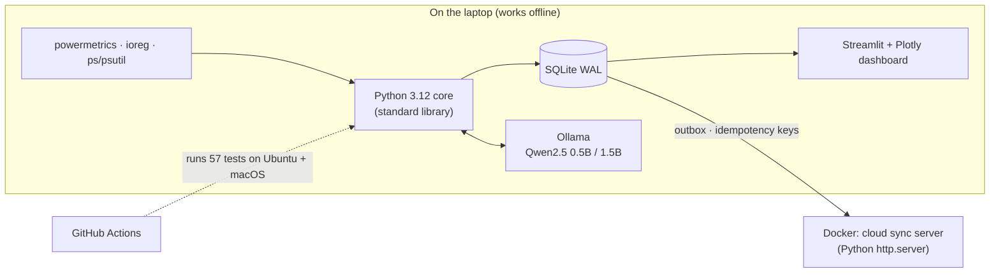

# Technical knowledge: every technology in Joule Receipts

For each technology: **what it is**, **why it was chosen**, **where it is used** in this repo, and **why it matters**
for the problem statement. Grouped by layer, from the sensor up to the cloud.

Contents:
1. [Overview](#1-overview)
2. [Language and runtime](#2-language-and-runtime)
3. [Energy measurement](#3-energy-measurement)
4. [Local AI](#4-local-ai)
5. [Analytics and statistics](#5-analytics-and-statistics)
6. [Storage](#6-storage)
7. [Offline-first sync](#7-offline-first-sync)
8. [Integrity and certification](#8-integrity-and-certification)
9. [Frontend](#9-frontend)
10. [Deployment, testing and tooling](#10-deployment-testing-and-tooling)
11. [Design principles behind the choices](#11-design-principles-behind-the-choices)
12. [Glossary](#12-glossary)

---

## 1. Overview

| Layer | Technology | One-line reason |
|---|---|---|
| Language | Python 3.12, standard library core | one language for sensing, AI, statistics and UI; no install needed for the core |
| Measurement | Apple `powermetrics`, battery gauge (`ioreg`), `ps` / `psutil` / `top` | real watts with no extra hardware |
| Local AI | Ollama + Qwen2.5-0.5B / 1.5B (4-bit) | under 4B parameters, fully offline, Apache-2.0 |
| Analytics | Markov chain, Apriori, power model (hand-written) | light, explainable, no ML library needed |
| Statistics | trapezoidal integration, medians, exact Mann–Whitney U | robust proof of a saving from a few runs |
| Storage | SQLite (WAL, `synchronous=FULL`) | crash-safe, serverless, one file |
| Sync | transactional outbox, idempotency keys, backoff + jitter, leases | survives restarts, no lost or duplicate items |
| Integrity | SHA-256 hash chain | tamper-evident receipts, verified by the cloud |
| Frontend | Streamlit, Plotly, custom CSS, Material icons | readable dashboard built fast |
| Deployment | Docker + Docker Compose | the "cloud" can be stopped and started for the offline demo |
| Quality | `unittest`, GitHub Actions, Makefile | every result reproducible and tested |

## 2. Language and runtime

### Python 3.12
* **What:** general-purpose language; the dashboard's virtual environment uses Python 3.12, the core also runs on 3.11.
* **Why:** one language for reading sensors, statistics, talking to the local AI, the database and the UI.
* **Where:** everything in `joule/`.
* **Why it matters:** judges and other students can read and run it; no compilation step.

### Python standard library (the core needs no installs)
| Module | Used for | Where |
|---|---|---|
| `sqlite3` | local database | `joule/db.py` |
| `urllib.request` | HTTP calls to Ollama and the cloud | `joule/slm/client.py`, `joule/sync/worker.py` |
| `http.server` | the cloud sync server | `joule/sync/server.py` |
| `threading` | background sampler, sync worker | `joule/experiment.py`, `joule/sync/worker.py`, dashboard |
| `subprocess` | `powermetrics`, `ps`, `top`, workloads, certify | `joule/sensors/`, `joule/workloads.py`, `joule/certify.py` |
| `hashlib` | SHA-256 chain, output checksums | `joule/chain.py`, `joule/certify.py`, `joule/workloads.py` |
| `statistics`, `itertools`, `math` | medians, Mann–Whitney, rounding | `joule/energy.py` |
| `json`, `re`, `dataclasses`, `argparse` | facts, grounding, data types, CLI | across `joule/` |

* **Why it matters:** the offline core runs on any Mac or Linux machine with Python and nothing else, which is
  exactly what an offline-first tool needs. Only the dashboard needs extra packages.

## 3. Energy measurement

### Apple `powermetrics`
* **What:** a macOS command-line tool that reports power of the Apple-silicon chip: CPU, GPU and Neural Engine (ANE),
  in milliwatts, over a chosen sampling window.
* **Why:** it is the most accurate power reading available on a Mac without extra hardware; labelled **MEASURED**.
* **Where:** `joule/sensors/powermetrics.py` (runs `powermetrics --samplers cpu_power,gpu_power -i 1000 -n 1` and
  parses "Combined Power").
* **Limits:** needs `sudo`; measures the chip only (not the display, SSD or Wi-Fi); 1 s windows, so very short
  workloads are repeated until a run lasts ≥ 15 s.
* **Why it matters:** PS 04 asks for the method, sampling interval, hardware and limitations; this is the
  **measured** half of "measured vs estimated".

### Battery gauge (`ioreg AppleSmartBattery`)
* **What:** the battery's voltage × current = whole-laptop power, readable without `sudo`.
* **Why:** a MEASURED fallback when `sudo` is not available (laptop unplugged).
* **Where:** `joule/sensors/battery.py`.
* **Limits:** the M3 gauge refreshes only every ~12–33 s and lags load changes, so experiments with it use ≥ 90 s
  windows.

### `ps`, `psutil` and `top` (CPU utilisation and per-app attribution)
* **What:** process-level CPU usage.
* **Why:** to split chip power across apps (**ATTRIBUTED**) and to drive the CPU-based power estimate when no sensor
  is available (**ESTIMATED**).
* **Where:** `joule/sensors/procs.py` (`ps -A -o pid,pcpu,comm`), `joule/sensors/cpu_estimate.py` (`psutil` if
  installed, else `top` or `/proc/stat`).
* **Why it matters:** it answers "**who** is using the power", which turns a number into advice ("Chrome was ~25% of
  chip power").

### Simulated sensor
* **What:** a seeded model `P = P_idle + W_per_core × CPU-seconds per second + noise`.
* **Why:** tests, CI and Docker run on machines without Apple sensors; results are labelled **SIMULATED** and never
  mixed with measured ones.
* **Where:** `joule/sensors/simulated.py`.

## 4. Local AI

### Ollama
* **What:** a local server that runs open language models on the laptop (`localhost:11434`), using the Mac's GPU
  through Metal.
* **Why:** simple local HTTP API, handles model download, quantization and memory, works with no internet after the
  models are pulled.
* **Where:** `joule/slm/client.py` (native `/api/chat` and `/api/tags`, which also return token counts and timings).
* **Why it matters:** PS 04 requires an **offline** copilot; no data leaves the device and no cloud API key exists
  anywhere in the code.

### Qwen2.5-0.5B-Instruct and Qwen2.5-1.5B-Instruct
* **What:** small open instruction-tuned language models (0.49B and 1.54B parameters, Apache-2.0), run 4-bit
  quantized.
* **Why:** both are under the 4B limit, run fast on a laptop, and are good at rewriting short fact sheets in plain
  English. The 0.5B model answered every test explanation correctly with **56% less energy** (MEASURED).
* **Where:** `joule/slm/explain.py` (explanations), `joule/slm/report.py` (Markdown report), `joule/workloads.py`
  (the `cascade` and `inference` experiments).
* **Why it matters:** the copilot practises what it preaches: the smallest model that passes the fact check is used.

### Model cascade + grounding check
* **What:** the small model writes first; a deterministic checker compares every number in its text with the
  computed facts; only on failure does the larger model try, then a template.
* **Why:** small models can invent numbers ("hallucinate"); the checker makes that impossible to show, and the
  cascade spends the larger model's energy only when needed.
* **Where:** `joule/slm/grounding.py`, `joule/slm/explain.py` (`explain_cascade`), `joule/policy.py` (which models).
* **Why it matters:** an energy tool that shows wrong numbers is worse than none. Full rules:
  [CERTIFICATION_AND_RULES.md §7](CERTIFICATION_AND_RULES.md#7-the-ai-fact-check-grounding-and-the-model-cascade).

### Energy meter for AI answers
* **What:** a background sampler reads the power sensor while the model writes; energy = mean power × duration.
* **Where:** `joule/slm/meter.py`; shown as `⚡ 6.8 J` under every explanation.
* **Why it matters:** few tools measure **their own** AI; this one does, per answer.

## 5. Analytics and statistics

### Trapezoidal integration
* **What:** energy = area under the power-vs-time curve, summing trapezoids between readings.
* **Why:** the standard way to turn irregular power samples into watt-hours.
* **Where:** `joule/energy.py` (`integrate_wh`, `mean_power`).

### Medians and the exact Mann–Whitney U test
* **What:** a rank-based test that asks "are the optimized runs consistently lower than the baseline runs?",
  computed exactly by enumerating every way to split the runs (fine for up to 20 runs).
* **Why:** energy runs are noisy and a single disturbed run (another app waking up) would wreck a mean-based test;
  medians and ranks are robust and need no normality assumption.
* **Where:** `joule/energy.py` (`mann_whitney_p`, `compare`).
* **Why it matters:** it is the difference between "it seemed to save energy" and "proven, p = 0.008". It also made
  the app refuse to claim the first noisy idle result (p = 0.33).

### Interleaved A/B experiments with a pilot prediction
* **What:** baseline and optimized runs alternate (B, O, O, B, …) after an idle measurement; a small pilot run first
  predicts the saving.
* **Why:** alternation cancels slow drift (temperature, battery level, background apps); the pilot shows how good the
  forecast was (batching: within 0.3%).
* **Where:** `joule/experiment.py`, `joule/workloads.py`.

### Markov chain
* **What:** a model of how the laptop moves between workload states (idle, light, busy, heavy) second by second.
* **Why:** gives the expected idle stretch, the chance of being idle soon, and the number of short wake-ups per hour,
  which is the signal for batching advice.
* **Where:** `joule/analytics/markov.py`; used in `recommend.py` and the Live page.

### Apriori (frequent itemsets with lift)
* **What:** a classic data-mining algorithm that finds sets of items that often appear together; here, processes
  that are active together in high-power seconds more than they are overall (lift).
* **Why:** finds apps that wake up together, so their work can be scheduled together.
* **Where:** `joule/analytics/apriori.py`; recommendation rules in `recommend.py`.

### Power model and calibration (least squares)
* **What:** `P = P_idle + (P_max − P_idle) × CPU utilisation`, fitted by least squares against a MEASURED sensor at
  0, 1, 2 and 4 busy cores.
* **Where:** `joule/sensors/cpu_estimate.py`, `joule/analytics/power_model.py` (`joule calibrate`).
* **Why it matters:** makes ESTIMATED numbers closer to real when no sensor is available.

### Anomaly detection, what-if models, energy label
* Ratio-to-usual anomaly rules (`anomaly.py`), two-point fitted models for the sliders (`whatif.py`), and the A–G
  label (`label.py`). All are fixed formulas, documented in [CERTIFICATION_AND_RULES.md](CERTIFICATION_AND_RULES.md).

## 6. Storage

### SQLite with WAL and `synchronous=FULL`
* **What:** an embedded SQL database in one file (`data/joule.db`). **WAL** (write-ahead log) lets the dashboard read
  while the collector writes; `synchronous=FULL` makes every committed transaction survive a crash or power loss.
* **Why:** no server to install or run, works offline, transactional.
* **Where:** `joule/db.py` (readings, per-app readings, experiments, runs, recommendations, predictions, reports,
  decisions, receipts, outbox, settings) with automatic schema migrations.
* **Why it matters:** PS 04's "persistent outbox that survives restarts" needs durable, transactional storage on
  the device.

## 7. Offline-first sync

### Transactional outbox pattern
* **What:** instead of calling the cloud directly, every event is written to an `outbox` table **in the same
  transaction** as the data it describes; a separate worker sends it later.
* **Why:** a crash can never leave a decision saved but not queued (or queued but not saved).
* **Where:** `joule/sync/outbox.py`, `joule/db.py`.

### Idempotency keys
* **What:** each item carries a unique key; the server stores it as a primary key and answers `duplicate` to a
  repeat.
* **Why:** if the server processed an item but the reply was lost, the retry is harmless: processed exactly once.
* **Where:** `joule/sync/outbox.py` (UUID keys, `chain:<hash>` for chain entries), `joule/sync/server.py`.

### Exponential backoff with jitter, leases
* **What:** failed sends wait 2 s, 4 s, 8 s … (max 5 min), multiplied by a random 0.5–1.0; claimed items hold a 30 s
  lease that expires if the worker crashes.
* **Why:** avoids hammering a recovering server; no item is stuck forever.
* **Where:** `joule/sync/outbox.py`, `joule/sync/worker.py`.

### Cloud sync server (Python `http.server`)
* **What:** a small HTTP server with `/events`, `/stats`, `/health` and `/chain`, storing events in its own SQLite.
  It can inject failures (`fail_rate`, `drop_response_rate`) to prove retries and dedupe.
* **Where:** `joule/sync/server.py`; runs in Docker.

## 8. Integrity and certification

### SHA-256 hash chain
* **What:** each receipt's hash covers the previous receipt's hash, its id, its time and its canonical JSON body;
  the chain starts from 64 zeros.
* **Why:** editing any receipt changes its hash and breaks every link after it, so tampering is visible.
* **Where:** `joule/chain.py` (shared by the laptop and the cloud), `joule/db.py`, `joule/sync/server.py` (`/chain`).
* **Why it matters:** "receipts" must be trustworthy; the cloud verifies the chain independently of the laptop.

### Energy label and software certification
* **What:** an A–G grade like an appliance sticker, CERTIFIED only under five written rules; developers certify
  their own code by comparing two versions with identical output.
* **Where:** `joule/analytics/label.py`, `joule/certify.py`; rules in
  [CERTIFICATION_AND_RULES.md](CERTIFICATION_AND_RULES.md).

## 9. Frontend

### Streamlit
* **What:** a Python framework that turns a script into a web app.
* **Why:** a full interactive dashboard in Python, no separate frontend codebase; runs locally on `localhost:8501`.
* **Where:** `joule/dashboard.py` (8 pages: Overview, Receipts, Certify, Advice, What-if, Live, Sync, Report).
  Uses fragments that refresh every 3–5 s for live data, a cached background sync thread, and long jobs launched as
  separate processes so the page stays responsive.

### Plotly
* **What:** interactive charts.
* **Where:** power over time, per-app bars, state shares, run dot plots, what-if curves in `joule/dashboard.py`.
* **Why:** hover tooltips with exact values, one consistent colour palette (blue = optimized, orange = baseline),
  and table views under the main charts.

### Custom CSS, drawn icons, Material icons
* **What:** a dark "control room" theme, the printed-receipt card, energy-label bars, line icons drawn as SVG, and
  Streamlit's built-in Material icons on buttons (served locally, so they work offline).
* **Where:** the `CSS` block and `ICONS` set in `joule/dashboard.py`; theme in `.streamlit/config.toml`.

## 10. Deployment, testing and tooling

### Docker and Docker Compose
* **What:** containers; Compose defines the `cloud` service (and an optional `sim` service for simulation runs).
* **Why:** the cloud server runs isolated and can be **stopped and started** to demonstrate offline → reconnect;
  its data lives in a named volume.
* **Where:** `Dockerfile.cloud`, `Dockerfile`, `docker-compose.yml`.

### unittest + GitHub Actions
* **What:** 57 standard-library tests (energy maths, statistics, sensors, grounding, outbox, sync with fault
  injection, chain, labels, anomalies, what-if, Goal, cascade, certify); GitHub Actions runs them on Ubuntu and macOS
  on every push.
* **Where:** `tests/`, `.github/workflows/ci.yml`.
* **Why it matters:** proves the logic works on two operating systems, offline, without Apple sensors (simulated).

### Makefile, uv / virtual environment
* **What:** `make dashboard`, `make test`, `make experiments`, …; `uv` creates the `.venv` with the dashboard
  packages (streamlit, plotly, psutil).
* **Where:** `Makefile`.

### Mermaid (documentation)
* **What:** text-based diagrams and charts that GitHub renders.
* **Where:** `README.md` and these docs.

## 11. Design principles behind the choices

| Principle | How the technology choices follow it |
|---|---|
| **Offline first** | local AI (Ollama), local database (SQLite), outbox sync; the cloud is optional |
| **Measured over estimated** | powermetrics first; every number carries a trust label; estimates are never called measurements |
| **The AI never computes numbers** | deterministic analytics compute facts; the model only writes sentences; a checker verifies |
| **Prove, don't claim** | interleaved A/B runs, medians, exact test, same-work check, receipts |
| **Tamper-evident** | SHA-256 chain verified by a second party (the cloud) |
| **Small is enough** | the smallest model that passes the check; standard-library core |
| **Reproducible** | seeded simulation, fixed workloads with checksums, tests in CI, one-command scripts |

## 12. Glossary

| Term | Meaning |
|---|---|
| W, Wh, mWh, J | power (watts); energy (watt-hours; 1 mWh = 3.6 J) |
| SoC | system on a chip (CPU + GPU + Neural Engine on Apple silicon) |
| SLM | small language model (here, under 4B parameters) |
| Quantization (4-bit) | storing model weights with fewer bits so the model is smaller and faster |
| Grounding | checking that every number in AI text comes from the facts |
| Provenance | where a number comes from: MEASURED, ATTRIBUTED, ESTIMATED, SIMULATED |
| Median | the middle value; not moved by one extreme run |
| p-value | how likely a result this extreme is if there were no real difference; < 0.05 = significant |
| Interleaving | alternating baseline and optimized runs so drift affects both |
| Idempotency key | a unique id that lets the server ignore repeats |
| Outbox | a local table of events waiting to be sent |
| WAL | SQLite's write-ahead log: concurrent reads and crash safety |
| Hash chain | records linked by hashes so any edit is detectable |
| Lift (Apriori) | how much more often items appear together than by chance |
| Markov chain | a model of moving between states with fixed transition probabilities |
